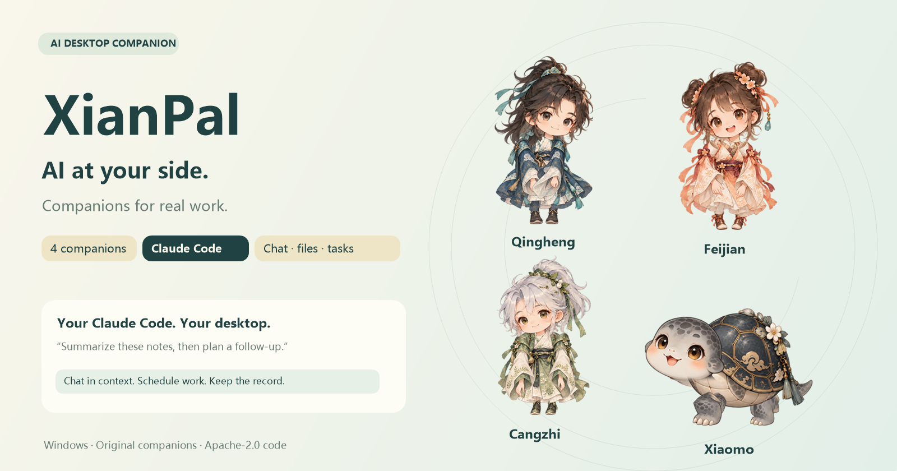
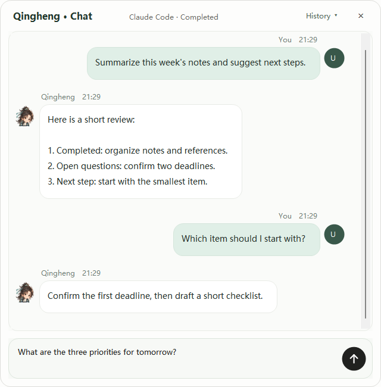
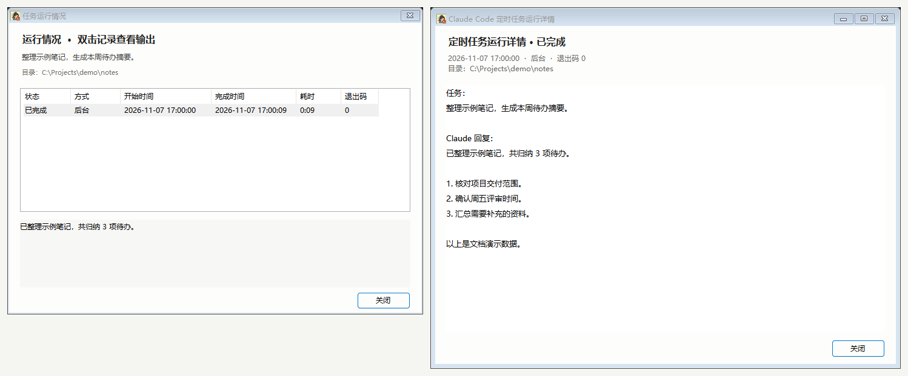
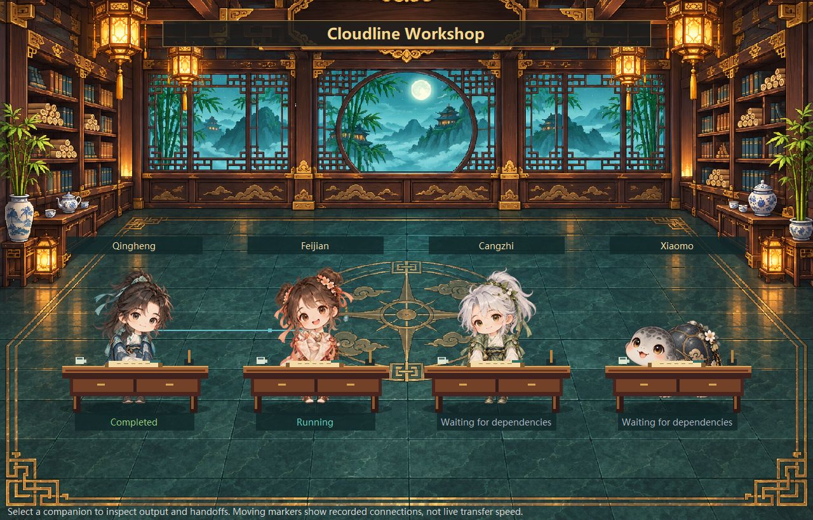
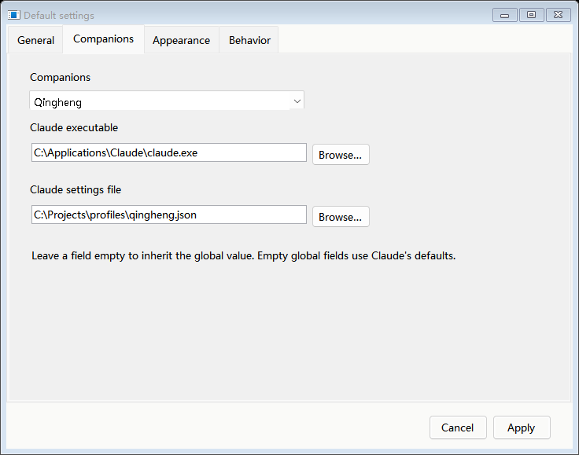
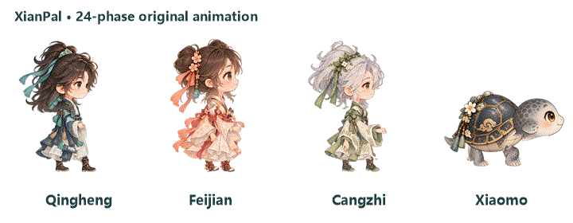
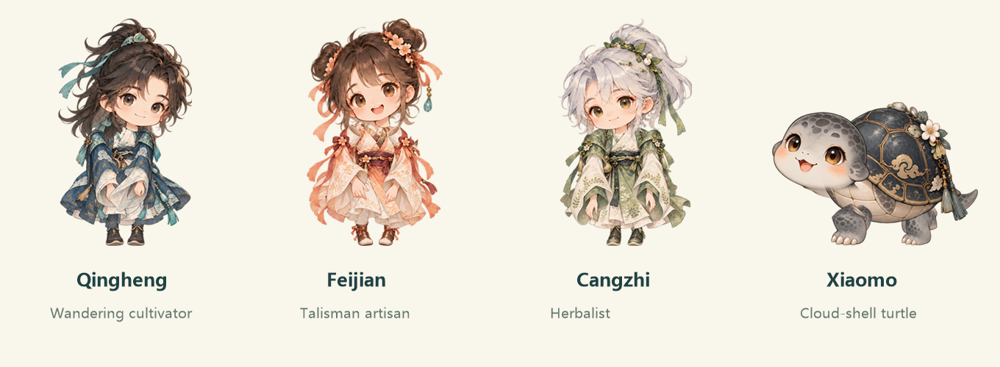

<div align="center">

# XianPal

**An animated desktop companion for Claude Code.**

[简体中文](README.zh-CN.md) · [Get started](#get-started) · [Features](#features) · [Create a companion](#custom-characters) · [Download](https://github.com/AHuaWinliver/xianpal-ai-companion/releases)



</div>

Chat beside one of four animated companions, drop a file into a Claude Code conversation, or schedule recurring work. For tasks that need several roles, set up a team and follow each agent's progress and handoffs in the workshop hall.

## Get started

1. On Windows 10 or 11, download and run `XianPal-*-Setup.exe`. Verify the file against the published SHA256 checksum. To try the features in the current source tree, [build from source](#build-from-source). [GitHub Releases](https://github.com/AHuaWinliver/xianpal-ai-companion/releases)
2. Before using AI features, make sure `claude` starts in your terminal and connects to the service you configured. Desktop interactions and local reminders work independently.
3. Right-click the companion and open **Default settings (默认设置)** to choose a working directory and Claude configuration. Double-click a reply bubble to continue the conversation. Use the tray menu to hide or restore the companion.

[Setup guide in Chinese](docs/GETTING-STARTED.md) · [Changelog](CHANGELOG.md)

<a id="features"></a>
## Features

### Desktop chat and files

Double-click a reply bubble to open the chat beneath your companion. Your messages appear on the right and replies on the left. You can select and copy text or drag the chat header to move the window and companion together. Drop a file or folder onto the companion, then confirm the request and working directory before sending it to Claude Code.



### Scheduled tasks and run history

Open **Claude Code scheduled tasks (Claude Code 定时任务)** from the companion menu. Enter a request and working directory, then choose a daily, weekly or interval schedule. Choose a background or terminal mode and decide whether to skip or start a run while the previous one is still active.

Scheduled output appears in **Run history (运行情况)**, separate from regular chat. Double-click a record to follow captured output or read the saved task and reply.

<a id="scheduled-task-history"></a>



### Events and multi-agent teams

Open **Event planning / Team workshop (事件规划 / 门派协作)** to schedule an event or create a team. Start with Qingheng as planner, Feijian as implementer, Cangzhi as reviewer and Xiaomo as verifier, or define your own roles, working directories and dependencies.

The hall uses the desktop companions' original animation frames and scales them with the window. Light pulses show recorded handoffs. Select a team member to see output and handoff summaries. Scheduled events ask for confirmation before execution. [Workshop guide](docs/WORKSHOP.md) · [Companion roles](docs/COMPANION-ROLES.md)

<a id="sect-hall"></a>



### Claude settings for each companion

Right-click the companion and open **Default settings → Claude settings file (默认设置 → Claude 配置文件)**. Choose a shared JSON file or set an override under **By companion (按角色设置)**. Team members use their own profiles. Scheduled tasks use the companion active when the run starts. The same menu also gives you control over the working directory, docked opacity and virtual desktop visibility.

<a id="claude-settings"></a>



*UI images use demonstration data.*

<a id="desktop-motion"></a>
### Desktop interactions and reminders

Each companion has its own animations and expressions. Steps follow the cursor's speed while dragging. Companions can dock at the screen edge and ride their own artifacts on long roaming routes.




Set a daily reminder or countdown. Daily reminders can play a character-specific performance or show a popup. Countdowns use a popup. Below is Qingheng's sword flight, which you can dismiss with **Esc**. [Performance guide](docs/REMINDER-PERFORMANCES.md)


<a id="custom-characters"></a>
## Create a companion



Right-click the companion, open the character menu and select **Open character resource folder (打开角色资源目录)**. Copy a complete character pack into the folder. XianPal validates and loads character packs while it runs.

1. Use the [character specification](docs/templates/CHARACTER-SPEC.md) and [profile template](docs/templates/character-profile.json) to define the look, personality, quotes, art sources and reminder style.
2. Draw transparent frames and check both walking directions, joint connections, expressions and clipping. Use opposite arm and leg motion for bipeds and diagonal alternation for quadrupeds. External characters use their own frames with built-in performance timelines.
3. Follow the [character pack guide](docs/CHARACTER-PACKS.md) to export and load your pack. Check idle, motion, interaction and performance states on the desktop and in the offline previews.

To extend built-in characters, rigs or performance timelines, see the asset entry points, anchors and review checklist in the [character customization guide](docs/CHARACTER-CUSTOMIZATION.md).

## Build from source

You need Windows 10 or 11, PowerShell and the system .NET Framework 4.x compiler. Clone or extract the source, then run these commands from the repository root.

```powershell
powershell -NoProfile -ExecutionPolicy Bypass -File .\build.ps1
.\build\payload\OrbitPet.exe
```

Find the installer in `dist/` and offline animation and performance previews in `build/previews/`. Pass `-SkipInstaller` to build the app and previews only. [Development and testing guide](docs/DEVELOPMENT.md)

## Contributing

Original characters, animation tools, desktop fixes, tests and translations are welcome. Discuss changes in [Issues](https://github.com/AHuaWinliver/xianpal-ai-companion/issues) and follow the [contribution guide](CONTRIBUTING.md). Major features include images and instructions in both READMEs.

## Privacy and license

Your Claude Code configuration and service determine AI requests, file permissions and usage. The installer adds current-user integration hooks and backs up the Claude settings, preserving existing handlers. [Privacy and configuration](docs/PRIVACY.md) · [Security reporting](SECURITY.md)

Code is licensed under [Apache-2.0](LICENSE). See the [asset license](ASSET-LICENSE.md) and [art provenance](art/PROVENANCE.md) for the bundled characters.
