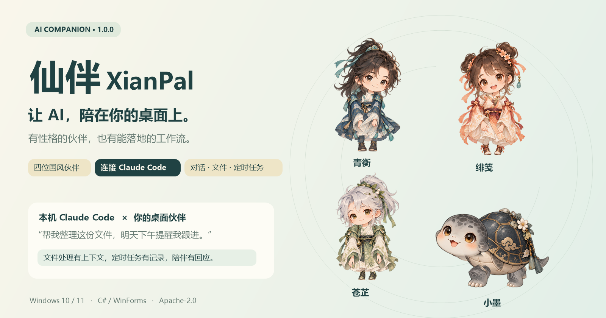
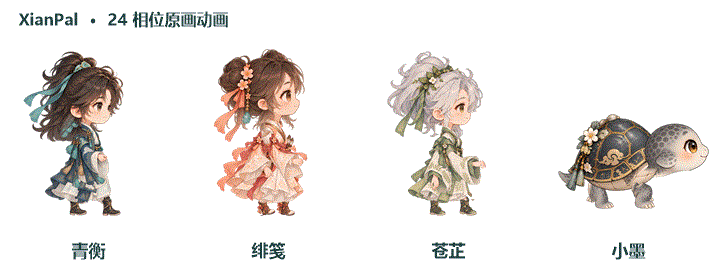
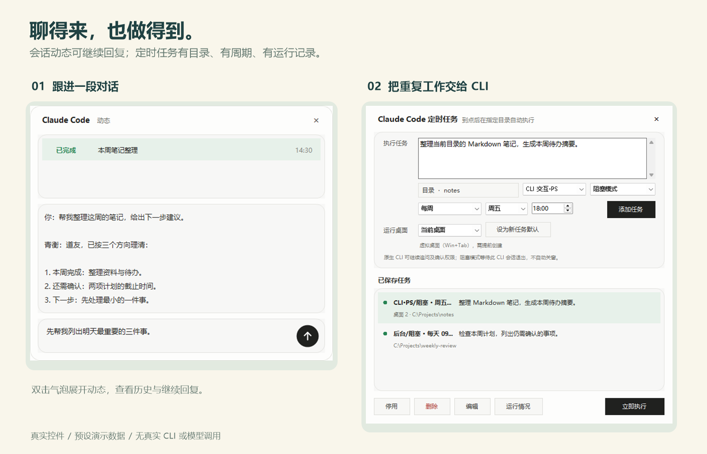

<div align="center">



# XianPal · AI Desktop Companion

**Give your AI a place on your desktop, not just in a chat window.**

Four original chibi companions × your local Claude Code CLI × conversations, files and scheduled work

[](CHANGELOG.md)

[](LICENSE)

[中文](README.md) · [Releases](https://github.com/AHuaWinliver/xianpal-ai-companion/releases) · [Create your own companion](#custom-characters) · [Build from source](#build-from-source)

</div>

XianPal combines a lively Windows desktop companion with a practical Claude Code workflow. Chat beside your pet, hand it a file, schedule recurring work, and let a character-specific performance remind you when it is time to pause.

The desktop app runs locally. **AI features require a separately installed, configured and authorized Claude Code CLI.** No model or API key is included; local execution does not mean offline inference.

**0.5 is an open preview, built to evolve with contributors.** The current release is **0.5.0**, not a 1.0 stable release. Features, interfaces and asset formats may change. Issues, original characters and code PRs are welcome; back up configuration and try tasks in a test directory before using important data.

## Four companions, four personalities


| Companion | Personality | Reminder performance |
| --- | --- | --- |
| Qingheng / 青衡 | A dependable, thoughtful cultivator | Summons a flying sword, takes an aerial circuit and lands with a reminder |
| Feijian / 绯笺 | A cheerful, meticulous talisman artisan | Dancing talismans, a small leap and rose-colored light |
| Cangzhi / 苍芷 | A quiet, considerate herbalist | Unfurling vines, drifting leaves and gentle firefly light |
| Xiaomo / 小墨 | A steady charcoal turtle with golden cloud patterns | A little hop followed by expanding ink-and-gold ripples |

<div align="center"></div>

The supplied transparent artwork is animated locally: 24-phase gait, articulated elbows, subtle neck motion and independently timed expressions. No image-generation service is called during build or installation.

## A companion that can help you work



*UI examples use real controls and synthetic demonstration data, not private conversations or a live model run.*

- **Chat:** latest-reply bubbles, a persistent activity window and follow-up replies.
- **Files:** drag a file or folder onto the pet, then confirm the request and working directory. The eating animation **does not delete the original file**.
- **Tasks:** daily, weekly and interval schedules; explicit directories; block or parallel execution; run history and past conversations.
- **CLI modes:** background execution, visible PowerShell / Windows Terminal, native CLI interaction, and native Background on compatible CLI versions.
- **Desktop life:** hover interactions, drag-to-follow movement, roaming, edge docking, translucent light trails, desktop-1 / all-desktop display and tray hide/restore.
- **Character hot updates:** add or replace data-only character packs while the app runs, without reinstalling.
- **Reminders:** countdowns and daily reminders, character performances or a quiet popup, reduced motion, Esc dismissal and snooze.

<div align="center"></div>

## Get started

1. Download `XianPal-0.5.0-Setup.exe` from [Releases](https://github.com/AHuaWinliver/xianpal-ai-companion/releases) and verify its published SHA256 when available.
2. Install on Windows 10 / 11. The installer adds a Start menu shortcut and the current user's integration hooks.
3. Right-click the pet to choose a character, set the Claude Code working directory or configure reminders and scheduled tasks.
4. Before using AI features, make sure Claude Code works normally in your terminal with your own account/service configuration.

The release link becomes available after the maintainer publishes the release. Until then, build from source. The installer is unsigned; Windows may display an unknown-publisher warning.

## Build from source

Requirements: Windows 10 / 11, PowerShell and the system .NET Framework 4.x compiler. No Node.js, NuGet restore, image-generation account or build-time API key is required.

You can also download and extract the repository ZIP. Git is only needed for the clone step below, not for compilation.
Prefer a short checkout path such as `C:\src\xianpal`; deeply nested directories can hit .NET Framework's traditional path-length limit.

```powershell
git clone https://github.com/AHuaWinliver/xianpal-ai-companion.git
cd xianpal-ai-companion
powershell -NoProfile -ExecutionPolicy Bypass -File .\build.ps1
.\build\payload\OrbitPet.exe
```

- Installer: `dist/XianPal-0.5.0-Setup.exe`
- App: `build/payload/OrbitPet.exe`
- Offline animation preview: `build/previews/index.html`
- Performance preview: `build/previews/performances.html`
- README media: `docs/images/`

Use `-SkipInstaller` for a development build. The application namespace is `XianPal`; the installer namespace is `XianPal.Installer`. The current public version is **0.5.0 (Preview)**.

The Windows startup entry and executable description use the software name, “仙伴 · AI桌面伴侣”. On normal launch, the updated app migrates an existing `OrbitPet` startup entry while preserving its command and Windows enabled/disabled state. It does not enable startup when no entry exists.

<a id="custom-characters"></a>
## Create your own companion

Give an original character its own appearance, personality and reminder performance. **0.5 supports external character packs without reinstalling or changing application source.** Right-click the pet → character menu → open the character resource folder, then copy in a complete pack. The app detects and validates changes; new characters appear in the menu and valid updates to the selected character apply live. Invalid updates keep the currently loaded artwork.

The default folder is `%LOCALAPPDATA%\XianPal\Characters`. A pack contains a profile, 240 transparent PNG frames across 12 states, and per-frame hashes—not a single-image automatic animator. See the [pack format and export tutorial](docs/CHARACTER-PACKS.md) (Chinese).

1. **Define the design:** copy the [character specification template](docs/templates/CHARACTER-SPEC.md). Record the character's identity, body type, personality, quotes and asset provenance. Approve normal and side views before animation; motion fixes must not redesign the face, clothes or proportions.
2. **Prepare transparent parts:** provide the head, torso, two complete arms/hands, two legs/boots and mouth/eye reference heads; quadrupeds use head/neck, body, four limbs and tail. Supply normal and walking views separately. Record reviewed pixel crops in `regions.json`, not an assumed regular grid.
3. **Attach and animate:** calibrate neck, shoulder, palm, hip and sole anchors. Use opposite arm/leg coordination for bipeds and diagonal alternation for quadrupeds. Walking needs at least 24 distinct phases, elbow bending and subtle neck motion. Both arms/forelimbs remain the topmost character layers.
4. **Add expression and performance:** preserve the head silhouette when changing eyes or mouth. Built-in rigs use local patches; external packs bake expressions into complete frames. Cover waving, reviewing, eating and mouth-wiping, then choose a preset performance while preserving reduced motion, Esc dismissal and single-monitor boundaries.
5. **Review before packaging:** inspect both walking directions, stopping, transitions, joint connections, transparency and clipping. Automated checks do not replace visual approval.

For resource-only characters, fill in the [profile template](docs/templates/character-profile.json), prepare the animation frames, and run [ExportCharacterPack.ps1](tools/ExportCharacterPack.ps1). The source entry points below are for extending the built-in renderer, rig or app capabilities:

| What to customize | Entry points |
| --- | --- |
| Name, personality, quotes and reminder style | [PetCharacter.cs](src/DesktopTasks/XianPal/PetCharacter.cs) |
| Layered art and crop regions | [art/rigs](art/rigs), [art/side-rigs](art/side-rigs), human walking torsos in [art/side-torsos](art/side-torsos) |
| Texture import, animation and expression generation | [BuildOriginalCharacters.cs](tools/BuildOriginalCharacters.cs) |
| Joint anchors, elbow curves, feet and gesture targets | [CompanionMotion.cs](src/DesktopTasks/XianPal/CompanionMotion.cs) |
| Asset loading, speed-adaptive playback and expressions | [PetForm.cs](src/DesktopTasks/XianPal/PetForm.cs), [PetForm.Expressions.cs](src/DesktopTasks/XianPal/PetForm.Expressions.cs) |
| Character-specific performance timeline | [ReminderPerformance.cs](src/DesktopTasks/XianPal/ReminderPerformance.cs) |

The IDs `orbit`, `spark`, `moss` and `pippin` are reserved for built-in characters. External packs use unique IDs and do not change built-in generation counts. Only new compiled-in rigs or rendering algorithms require geometry, preview and test extensions. See the [customization guide](docs/CHARACTER-CUSTOMIZATION.md) (Chinese) for rigging and artwork rules.

From the project root on Windows:

```powershell
# Generate assets, app and offline previews without an installer or model calls
powershell -NoProfile -ExecutionPolicy Bypass -File .\build.ps1 -SkipInstaller
.\tests\companion-motion-test.ps1
.\tests\original-assets-test.ps1
.\tests\reminder-performance-test.ps1
```

After building, open `build/previews/index.html` for animation review and `build/previews/performances.html` for performances. Keep original inputs in `art/`, `src/` and `tools/`; **never keep the only copy of handmade artwork inside the replaceable `build/payload` directory**.

Recipients only copy the exported pack; they need no compiler. External expressions are baked into complete frames, not overlaid with built-in head geometry. Reminder performances currently reuse four preset timelines with the pack's own images; executable content and custom timeline scripts are not loaded.

Use original art you have permission to license, and include actual prompts, reference permissions and edit records. Recoloring or renaming a known fictional character is not an original design. Read the [asset license scope](ASSET-LICENSE.md), [performance notes](docs/REMINDER-PERFORMANCES.md) and [contribution requirements](CONTRIBUTING.md) before submitting.

## Validate and contribute

### Help shape the next versions

Small, focused contributions are welcome: original characters and animation tools; multi-monitor, DPI and performance fixes; CLI/task compatibility and diagnostics; isolated tests, guides and translations.

Discuss the scope in [Issues](https://github.com/AHuaWinliver/xianpal-ai-companion/issues), then follow [CONTRIBUTING](CONTRIBUTING.md). Include reproduction steps and test results, plus previews for visual changes. Never upload credentials, private conversations or intranet data.

```powershell
.\tools\TestRepository.ps1
.\tests\release-source-test.ps1
.\tests\startup-registration-test.ps1
.\tests\character-pack-test.ps1
.\tests\smoke-test.ps1
.\tests\companion-motion-test.ps1
.\tests\original-assets-test.ps1
.\tests\reminder-performance-test.ps1
```

Tests use mocks or isolated directories, not paid model calls. Window, virtual-desktop and installer checks need a Windows desktop session. See actual CI results in [Actions](https://github.com/AHuaWinliver/xianpal-ai-companion/actions); local success is not a compatibility guarantee for every Windows environment.

Read [CONTRIBUTING](CONTRIBUTING.md), then share reproducible bugs or ideas in [Issues](https://github.com/AHuaWinliver/xianpal-ai-companion/issues). Never submit credentials, private work records or unauthorized character artwork.

## Privacy, permissions and limits

- AI requests follow your CLI configuration and may use the network or paid quota.
- Installation appends this app's hooks to the current user's Claude settings and creates a backup, preserving other handlers. See [privacy notes](docs/PRIVACY.md).
- This is **not a security sandbox**. File access and task execution follow your user account and CLI permissions. Do not automatically trust unfamiliar directories or prompts.
- Proactive AI features can be disabled. Capturing other local Claude sessions is off by default; the app does not automatically terminate them.
- Background support, Terminal availability, fonts and virtual-desktop behavior depend on your environment. Voice conversation is not included.
- No affiliation with Anthropic, Microsoft or an existing fictional franchise is claimed.

## License and documentation

Code is licensed under [Apache-2.0](LICENSE). The bundled AI-assisted original character art has a separately explained [license scope](ASSET-LICENSE.md) and [provenance record](art/PROVENANCE.md). AI generation is not an absolute non-infringement guarantee. System fonts are not redistributed.

[Development](docs/DEVELOPMENT.md) · [Character customization](docs/CHARACTER-CUSTOMIZATION.md) · [Performances](docs/REMINDER-PERFORMANCES.md) · [Publishing guide](docs/GITHUB-PUBLISH.md) · [Changelog](CHANGELOG.md) · [Security](SECURITY.md)

---

**A little presence. A practical helping hand.** If XianPal makes your desktop feel more welcoming, a Star is appreciated.
