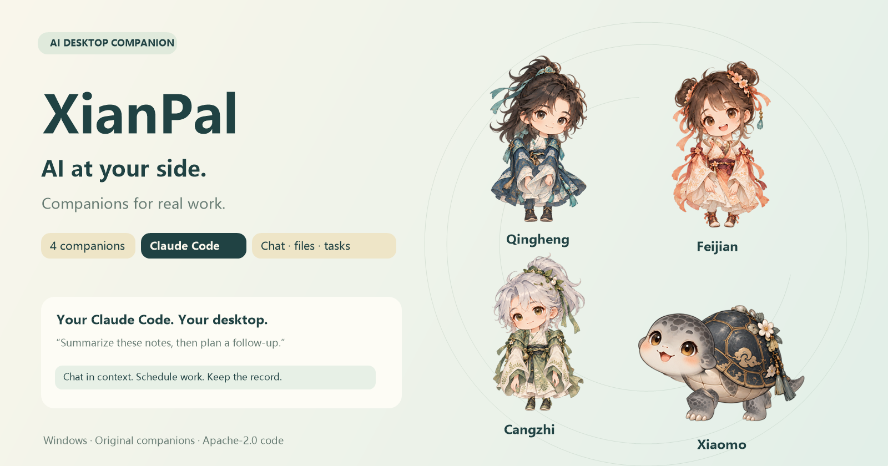
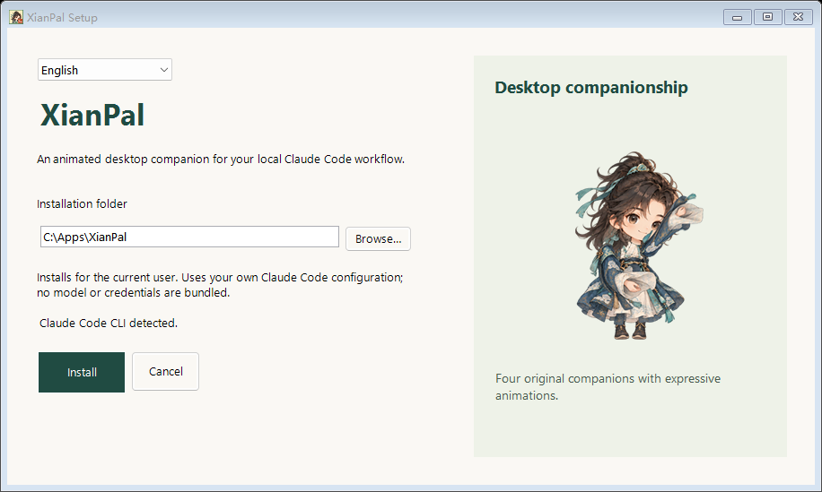
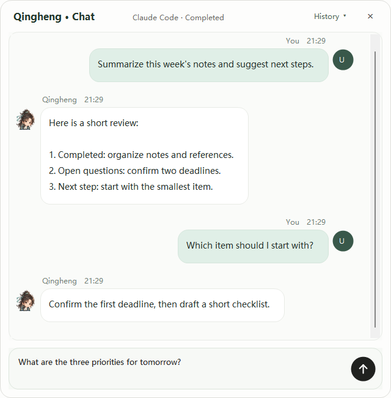
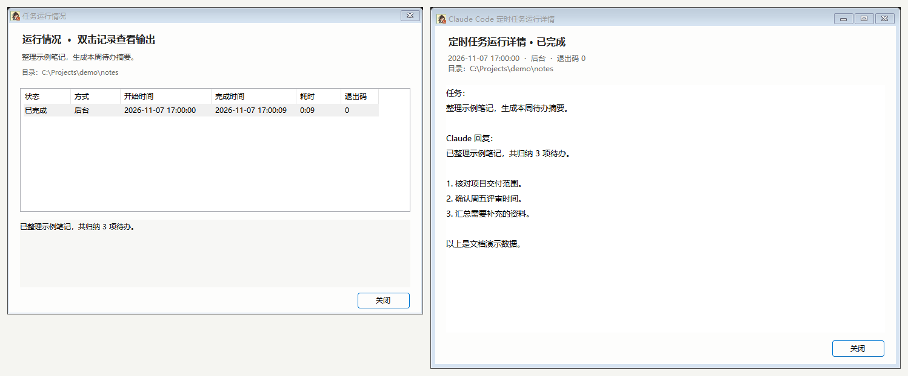
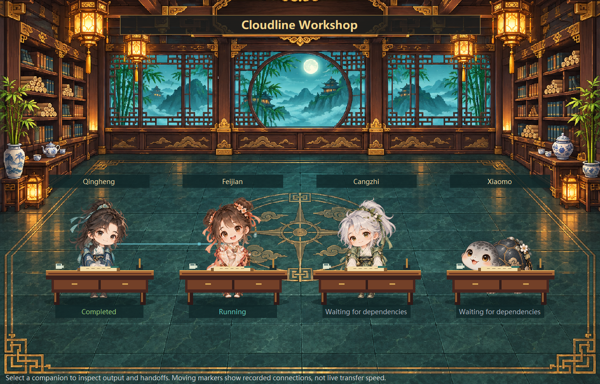
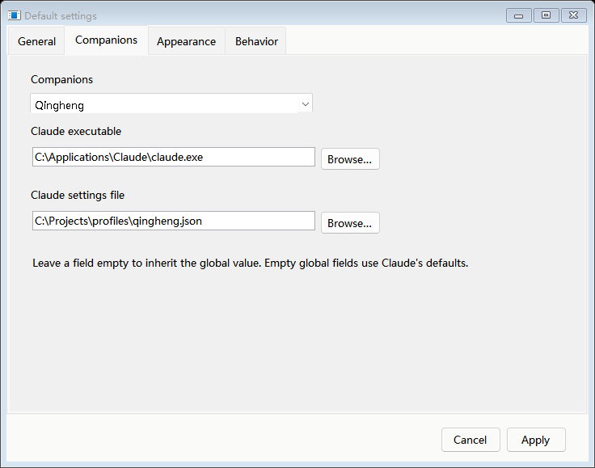
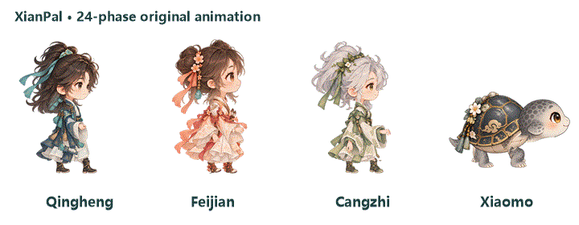
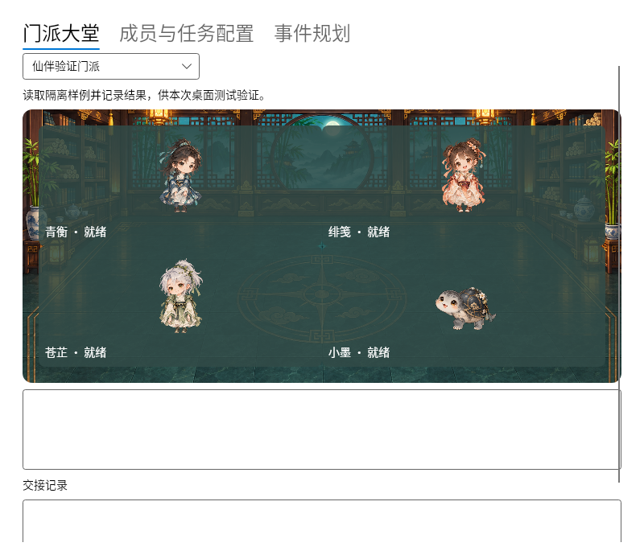

<div align="center">

# 仙伴 XianPal

**连接本机 Claude Code 的 Windows AI 桌面伴侣。**

[English](README.md) · [快速开始](#quick-start) · [功能](#features) · [定制角色](#custom-characters) · [下载](https://github.com/AHuaWinliver/xianpal-ai-companion/releases)



</div>

在桌面和四位国风伙伴对话，拖入文件交给 Claude Code 处理，或安排定时任务。需要分工时，可以组建门派，在大堂查看道友的进度与交接。

<a id="quick-start"></a>
## 快速开始

1. 在 Windows 10 / 11 上下载并运行 `XianPal-*-Setup.exe`，按发布页提供的 SHA256 核对文件。需要仓库中的最新功能时，可以[从源码构建](#build)。[GitHub Releases](https://github.com/AHuaWinliver/xianpal-ai-companion/releases)
2. 使用 AI 功能前，先在终端确认本机 `claude` 能启动并连接你配置的服务。桌面互动与本地提醒可独立使用。
3. 右键宠物，从 **默认设置** 选择工作目录和 Claude 配置。双击回复气泡可继续对话，右键托盘图标可隐藏或找回宠物。

[完整安装与使用说明](docs/GETTING-STARTED.zh-CN.md) · [更新日志](CHANGELOG.md)

<a id="features"></a>
在独立的 **默认设置** 窗口切换中英文，并为各道友选择 Claude 程序地址和配置文件。创建定时任务时可选择执行道友，任务窗口汇总全部道友并显示头像；切换当前宠物不改变任务归属。[道友配置与任务说明](docs/COMPANION-PROFILES.zh-CN.md)

<details>
<summary>查看安装界面</summary>

安装时可选择中英文、安装目录，并预览原版人物动作。



</details>

## 功能

### 桌面对话与文件处理

双击回复气泡，在角色下方打开对话。你的消息靠右，道友回复靠左，正文可选择和复制。拖动对话标题可让窗口和角色一起移动。把文件或文件夹拖给宠物，确认需求与工作目录后再发送给 Claude Code。



### 定时任务与运行记录

右键进入 **Claude Code 定时任务**，填写需求和工作目录，设置每日、每周或间隔运行。可选择后台或终端模式，也可设定上一次仍在执行时跳过或并行启动。

任务输出集中在 **运行情况**，与日常对话分开。双击记录可跟踪已捕获的输出，也可查看已保存的任务和回复。

<a id="scheduled-task-history"></a>



### 事件规划与门派协作

从右键菜单进入 **事件规划 / 门派协作**，安排事件或创建门派。可用青衡统筹、绯笺实施、苍芷审查、小墨验证的职责预设，也可自定义角色职责、工作目录和任务依赖。

大堂使用桌面角色的原始动画帧，随窗口缩放。光点显示成员之间已发生的交接，点击成员可查看输出和传递摘要。事件到点会通知你确认后再执行。[门派操作指南](docs/WORKSHOP.zh-CN.md) · [道友职责](docs/COMPANION-ROLES.zh-CN.md)

<a id="sect-hall"></a>



### 为每位道友设置 Claude

右键打开独立的 **默认设置** 窗口，在 **道友** 中为全局或各角色指定 Claude 程序地址与 JSON 配置。创建定时任务时选择 **执行道友**，任务按保存的归属取配置，不受当前显示宠物影响；列表汇总全部道友并显示头像。常规设置可切换中英文，调整工作目录与贴边透明度。[配置和任务归属说明](docs/COMPANION-PROFILES.zh-CN.md)

<a id="claude-settings"></a>



*界面图片使用演示数据。*

<a id="desktop-motion"></a>
### 桌面互动与提醒

四位伙伴有各自的动作和表情。拖动时步频随鼠标速度变化，靠近边缘可吸附，长距离漫游时会乘上各自的灵器。




设置每日提醒或倒计时。每日提醒可选角色专属演出或提示框，倒计时以提示框报时。下图是青衡的御剑演绎，可按 **Esc** 退出。[全屏演绎说明](docs/REMINDER-PERFORMANCES.zh-CN.md)


<a id="custom-characters"></a>
## 定制自己的角色


右键选择 **切换形象 → 打开角色资源目录**，复制完整的角色包。仙伴会校验资源并自动加载，适合在安装后添加或更新角色。

1. 复制[人物定制规格单](docs/templates/CHARACTER-SPEC.zh-CN.md)和[角色配置模板](docs/templates/character-profile.json)，定义造型、人设、台词、素材来源和提醒风格。
2. 绘制透明动作帧，检查双向步态、关节连接、表情和画面边缘。双足动作采用对侧手脚，四足动作采用对角交替。外置角色使用自己的动作帧与内置演绎时间线。
3. 按[角色包教程](docs/CHARACTER-PACKS.zh-CN.md)导出并热加载。在桌面和离线预览中检查待机、移动、交互和全屏演出。

要修改内置人物、动作骨架或演绎时间线，可查阅[人物定制与动画规范](docs/CHARACTER-CUSTOMIZATION.zh-CN.md)中的素材入口、连接锚点与验收清单。

<a id="build"></a>
## 从源码构建

需要 Windows 10 / 11、PowerShell 和系统 .NET Framework 4.x 编译器。克隆仓库或解压源码后，在项目根目录运行以下命令。

```powershell
powershell -NoProfile -ExecutionPolicy Bypass -File .\build.ps1
.\build\payload\OrbitPet.exe
```

安装包在 `dist/`，动作和演出预览在 `build/previews/`。只需要程序和预览时，可给构建脚本加上 `-SkipInstaller`。[开发与验证指南](docs/DEVELOPMENT.zh-CN.md)

## Linux 移植与兼容性

Linux 桌面端在 `linux` 分支开发，覆盖 x86_64 与 ARM64，并提供面向旧系统库的兼容构建。Ubuntu 原生环境与 CentOS 7 用户空间中的中文对话、后台任务和四道友依赖交接已通过自动化验证，中文与表情字体随包提供。完整功能与更多发行版仍在验证。[查看界面、验证结果与验收清单](docs/LINUX.md)



## 贡献

欢迎贡献原创角色、动画工具、桌面体验修复、测试和翻译。通过 [Issues](https://github.com/AHuaWinliver/xianpal-ai-companion/issues) 讨论改动，再按[贡献指南](CONTRIBUTING.md)提交。大功能更新需同步提供中英文 README 图文说明。

## 隐私与许可

AI 请求、文件权限和额度由本机 Claude Code 与所选服务管理。安装器会为当前用户添加联动 Hooks，备份 Claude 设置并保留其他处理器。[隐私与配置](docs/PRIVACY.zh-CN.md) · [安全报告](SECURITY.md)

代码采用 [Apache-2.0](LICENSE)。角色素材的授权范围与来源见[素材许可](ASSET-LICENSE.md)和[来源记录](art/PROVENANCE.md)。
