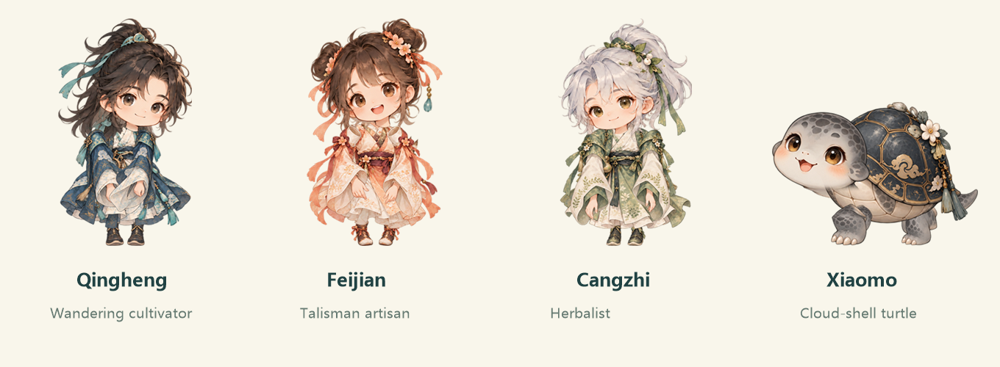
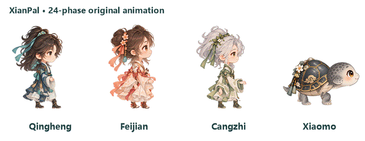

# Creating and animating companions

[简体中文](CHARACTER-CUSTOMIZATION.zh-CN.md)

Keep the approved character design fixed; change joint poses rather than regenerating its identity. Review the images and a complete motion cycle before packaging. Adding a data-only [character pack](CHARACTER-PACKS.md) does not require rebuilding the app. Extending the built-in renderer does.



Use the [character specification](templates/CHARACTER-SPEC.md) to record art sources, proportions, crops, anchors and review results. This is a 2D artwork/animation workflow, not a general 3D modeling system or a ready-made face editor.

## Choose the scope

| Change | Required work | Preserve |
| --- | --- | --- |
| Fix an existing motion | Anchors, paths, layering and focused tests | Identity, clothing, personality, scheduling and window behavior |
| Add an external companion | Complete frames, metadata and checksums | Existing built-in arrays and users' installation |
| Extend a built-in body type | Art, geometry, anchors, states, previews, loaders and tests | Stable IDs and migration behavior |
| Add a performance | Shared timeline, scenery, style mapping and previews | Reminder scheduling and task permissions |

Built-in IDs are `orbit` (Qingheng), `spark` (Feijian), `moss` (Cangzhi) and `pippin` (Xiaomo). Display names can change without changing these compatibility IDs. `PetCharacter.All` remains the build baseline; `Available` includes external packs. The built-in renderer has per-character calibration and count assertions: adding a row to metadata alone is insufficient.

## Authoring workflow

1. Preserve the approved artwork and baseline source in a backup or branch.
2. Record an original design, personality, body type, facing directions, layers, anchors and rights.
3. Approve normal and genuine side-view designs. The face, chest, collar, waist and toes must face consistently; do not squeeze a frontal image into a side view.
4. Create transparent separated parts. Inspect each actual crop rather than assuming a regular grid.
5. Check neck, shoulder, hip and boot connections while standing. Build at least 24 unique walking phases, then interactions and independent expressions.
6. Review left/right travel, stopping, turns, dragging, hover, file interaction and the final-to-first frame transition.
7. Design a personality-specific performance, verify one-monitor placement and reduced-motion/failure behavior.
8. Submit rebuildable artwork, actual prompts/provenance, crops, calibration, tests and previews. Export only after visual review.

AI-generated art is an optional authoring input. Check and save the result before building. The build itself must not call generation services or paid models.

### Suggested art brief

Create transparent layered art for an original chibi companion using its approved design as the sole identity reference. Keep head/body ratio, facial anchors, hair, clothing, patterns, outlines, lighting and palette unchanged. Supply a neutral head, torso, complete sleeves/arms/hands, legs including boots, and mouth/closed-eye references. A quadruped needs a head/neck, shell/body, four limbs and tail. Separate complete parts with transparent margins; record neck, shoulder, hip and sole anchors. No visible skeleton, joint balls, extra limbs, solid background or magenta edges.

Side-view additions must turn the whole design consistently. Expression references change only eyelids or mouth, preserving the skull, ears, hair, neck and original feature positions. A prompt is not a substitute for reviewing actual pixels and connections.

## Inputs and coordinate systems

| Entry | Purpose |
| --- | --- |
| `art/approved-design.png` | Approved identity baseline |
| `art/rigs/regions.json` | Normal/interaction parts and reviewed crop rectangles |
| `art/side-rigs/regions.json` | Side-view walking parts |
| `art/side-torsos/regions.json` | Corrected human side-view torsos |
| `tools/BuildOriginalCharacters.cs` | Import, rigs, mesh deformation, states and expression patches |
| `CompanionMotion.cs` | Neck/shoulder/hip anchors, elbow paths, palm targets and quadruped curves |
| `PetForm` and partials | Playback, movement, input, expressions and lifecycle |
| `ReminderPerformanceTimeline.cs` / `ReminderPerformance.cs` | Shared performance timing and Windows scenery rendering |

The first two region files map IDs to nine `[x,y,width,height]` rectangles in source pixels, not cell numbers or opposite corners. Part 0 is the head; 1 the torso/shell; 2–3 arms/front limbs; 4–5 legs/hind limbs; 6 mouth reference; 7 closed-eye reference; 8 reserved human part or turtle tail. The side-torso file maps each ID to one rectangle, not nine.

Output is 384 × 416 RGBA, rendered at 2× resolution before downsampling. Distinguish source pixels, render coordinates and local normalized UVs. Preserve aspect ratios. All poses need transparent margins, including raised sleeves, ears and tail. Low-alpha import noise (`A < 16`) is cleared, while real antialiased edges remain. This does not repair a colored background or fringe.

## Attachments, layers and facing

- Rotate/scale the head around the actual skin neck root, not the chin, image center or an old collar tip. Normal and walking heads have separate anchors. If the head art includes an old collar, exclude only that clothing region; do not cut the face or repaint a second collar over the hair.
- The turtle's neck narrows/retracts below its jaw into the shell front. Do not shrink its skull or hide a disconnected neck with a forelimb.
- Attach a sleeve using its opaque shoulder centroid. The first 16% stays fixed; the next roughly 18% transitions smoothly into rotation. Shared mesh boundaries prevent seams. Preserve the hand shape and explicitly check palm UVs.
- Hip roots inherit the torso's same-frame transform and remain inside the hem. Stance feet stay in ground coordinates. Connect trousers to the real boot opening; transform boot shaft, heel, toe and sole as one rigid shape.
- Turtle limb roots remain in shell sockets. Deform the lower limb to step; do not translate a whole limb out of the body.
- **Both human arms and both turtle forelimbs are drawn last**, above torso, collar, head, hair, shell and neck. This is the approved interaction layering rule. Do not redraw a mask over them afterward. Scenery stays behind the already composed companion.
- Human walking art faces right; turtle walking art faces left. Mirror the whole body, expressions and props together when required. Near/far limbs are not anatomical left/right; label the correspondence before checking coordination.

Neck inertia uses a small delayed angle `k × (2.1 sin(t−0.38) + 0.35 sin(2t−0.55))` degrees around the same attachment root. It should read as weight, not head shaking.

## Natural gait: 24 unique production phases



Use `phase = frame / N`, with the current contract `N = 24`. Eight contact diagrams can help review, but repeating eight images does not create a 24-phase walk. Do not duplicate frame zero at the loop end. Changing the count requires updating generation, loaders, interval calculations, previews and tests together.

The left leg moves forward with the right arm; the right leg with the left arm. Legs differ by half a cycle. Same-side arms and legs are approximately π apart, with slight arm/elbow lag. They retain one shared gait frequency; independent random limb frequencies eventually destroy coordination.

The current calibrated arm swing is `±18 cos(2πphase−0.16)` degrees; elbow bend is `24±10 cos(2πphase−0.32)` degrees. These are sleeve-specific values, not universal anatomy. Measure the actual palm/foot displacement after mirroring, not just angle signs. Extremes decelerate smoothly before reversing.

Feet use 60% stance / 40% swing. Stance soles stay at render `y=396` while traveling backward relative to the body. Swing uses smoothstep forward motion and a small sinusoidal lift. The knee flexes during swing without inversion or jitter. This is a simplified 2D gait, not a complete biomechanics or perfectly slip-free simulation at every speed.

Human body movement is deliberately small: about 0.75 px vertical, 0.9 px lateral and 0.45° rotation at the reference size. The sole must not inherit the body's bob. Turtle gait alternates diagonal limb pairs with small claw lift and shell movement; never apply the human two-leg rule to it.

Reuse existing velocity-based playback and accumulated drag distance. Slow movement uses lower cadence; faster movement raises it. Stopping returns to standing, and turning preserves phase. Do not rewrite collision, docking or window positioning to repair a limb animation.

## States, expressions and files

| States | Frames each | Review focus |
| --- | --- | --- |
| `idle`, `waiting`, `failed` | 8 | Stable stance, subtle changes, attached arms |
| `running`, `running-left`, `running-right` | 24 | Contralateral gait, soles, facing and margins |
| `waving`, `review` | 24 | Visible palms, gradual entry and exit |
| `jumping`, `punching` | 24 | Compatibility names do not require every character to punch |
| `eating`, `wiping-mouth` | 24 | Correct mouth target; raise → wipe across mouth → lower |

Each character has 240 frames. Four built-ins produce 960 frames, 48 normal/side expression patches and two compatibility images. Changing states or body types requires updating the complete pipeline, not only adding a folder.

`GestureMouth` uses render coordinates; `MouthX/MouthY` uses normalized coordinates. Calibrate both. Directional gestures use a 48-band curve through the shoulder and actual palm/claw; walking sleeves use 24 bands. An enlarged mouth must remain attached and recognizably part of the same face. File eating does not delete originals or bypass the request/directory confirmation flow.

Only local eye/mouth patches come from reference heads. Do not replace the full head. Normal and side patches align separately, with three blink and three mouth transition levels. Independent expression timing must not restart on every gait phase or turn. Keep caches bounded and dispose bitmaps. External packs encode expressions in their complete frames rather than using built-in patch anchors.

## Character-specific fullscreen performance

See [performance behavior and previews](REMINDER-PERFORMANCES.md).

| Style | Character | Storyboard |
| --- | --- | --- |
| `command` | Qingheng | Summon sword → stand aboard → arc through the scene → land |
| `beam` | Feijian | Raise sleeves → talisman orbit → light hop → settle |
| `warning` | Cangzhi | Raise hand → grow plants → tend them → fade leaves |
| `stone` | Xiaomo | Small hop → landing ink ripples → wave a claw → fade clouds |

Do not reuse a giant fist, screen shatter or strong flash for these characters. Sample elapsed time with `Stopwatch`, not timer ticks. Current timing: entrance ends at 1.12 s, card appears at 5.60 s, effects end at 6.24 s. A 16 ms redraw request does not guarantee 60 fps.

Layout uses the companion's single monitor. Character and prop share their sole pivot, rotation and facing. Measure actual feet for a new body shape; do not hardcode a built-in ratio. Flight uses planted feet, not airborne walking. Trails follow actual path history and taper/fade behind the character.

Windows uses premultiplied per-pixel alpha with a reusable native surface. Keep the card clear, avoid focus capture, preserve Escape/snooze, and release native resources on close or resize. Reduced motion and popup-only modes remain lightweight. If the effect surface fails, show a normal reminder rather than losing it or covering the desktop with black.

## Personality and provenance

`PetCharacter` defines personality, quotes and style; `PetBrain` builds requests. Accurate work, explicit failure reporting and permissions take priority over roleplay. Originality requires an independently designed silhouette, clothing, patterns, name and expression, not a renamed/recolored existing character.

Retain artwork, references and their permissions, actual prompts, tool/date and human revisions in [provenance](../art/PROVENANCE.md). Follow the [artwork license](../ASSET-LICENSE.md). AI assistance is not a guarantee of non-infringement; code's Apache-2.0 license does not grant unrelated artwork rights.

## Review and submission

```powershell
.\build.ps1 -SkipInstaller
.\tools\TestRepository.ps1
.\tests\release-source-test.ps1
.\tests\companion-motion-test.ps1
.\tests\original-assets-test.ps1
.\tests\desktop-visibility-test.ps1
.\tests\reminder-performance-test.ps1
.\tests\smoke-test.ps1
```

Inspect `build/previews/index.html` and `build/previews/performances.html`, including a full loop and frame 23 → 0. Rebuild after changes; do not review a stale browser cache. Numerical tests do not replace visual approval.

- [ ] All states preserve identity, proportions, outline, alpha and safe margins.
- [ ] Neck, shoulders, hips and boots remain connected, with arms/forelimbs outermost.
- [ ] Left/right travel, stops, turns and dragging retain coordinated limbs and grounded feet.
- [ ] Idle stops stepping; hover/gestures transition smoothly; expressions have independent rhythm.
- [ ] File preparation, swallow and mouth wiping are visible without deleting files.
- [ ] The selected character owns its performance on a single monitor at different sizes/scales.
- [ ] Popup, countdown, reduced motion, Escape, snooze and failure fallback remain usable.
- [ ] Long-running switching, scaling and effects do not grow caches or native resources without bounds.
- [ ] No unrelated task, trust, permissions or input changes are bundled into animation fixes.
- [ ] Rebuildable inputs, provenance, crops, calibration, previews and results accompany the PR.

For a new built-in renderer type, also update profile validation, per-ID geometry, directional artwork, frame/expression paths, performance style routing, preview layouts and count assertions. Explain new geometric thresholds rather than disabling tests. The source export uses `tools/PublicFiles.ps1`; include new required tools/tests in its allowlist.
