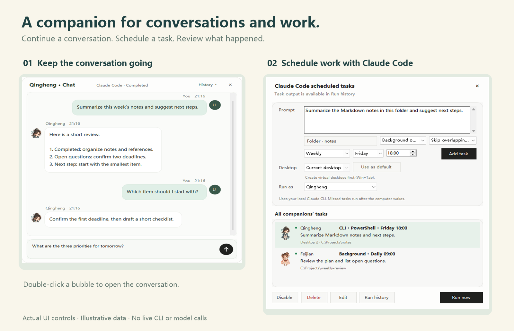

# Conversation interface

[简体中文](CHAT-UI.zh-CN.md)

Double-click the desktop reply bubble to expand a conversation below its companion. The initial position is computed before showing the window, within that companion's monitor. Windows can shorten the window or reposition the pair when space is limited. A very small display can still require overlap.

The desktop bubble is not selectable. Expanded conversations support selecting and copying text; they remain open until manually closed. Opening the pet's context menu hides the small reply bubble.

## Messages and updates

User messages appear on the right and companion replies on the left. Explicit speaker metadata separates new turns; the app does not infer user messages from quoted text such as “You:”. Legacy or native CLI output without trustworthy turn metadata remains one intact output block. Native CLI conversations continue in their terminal.

Windows merges streaming updates about every 120 ms and preserves selections and scroll position. The Linux port uses a 100 ms update interval. This limits token-by-token flicker without discarding text. New output follows the bottom only when the reader was already there.

Windows uses `RICHEDIT50W` and font fallback; Chinese text is not assigned an emoji font. Emoji color depends on the OS. Enter sends and Shift+Enter adds a line, with an IME composition guard. The Linux conversation currently uses Ctrl+Enter to send. New sends are disabled while a response is running.

## Moving the pair

On Windows, drag the title area, companion name or status after a small movement threshold. The pet follows while text and buttons keep their normal interactions. Positioning uses the monitor under the pointer and ends cleanly on release, lost capture or close. On Linux, moving the native conversation window updates the companion position through window-position events.

Message activity is local to the current run; this interface does not add a permanent chat database. Scheduled-task transcripts remain in their separate persisted run history.

Validation: `tests/chat-bubble-test.ps1`, `tests/chat-drag-test.ps1` and the CLI integration tests. They use isolated fixtures rather than paid model calls.
