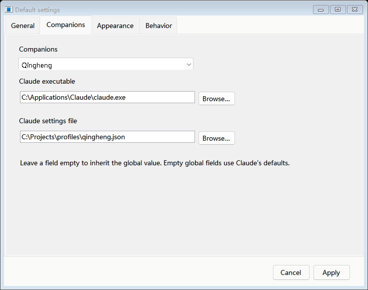
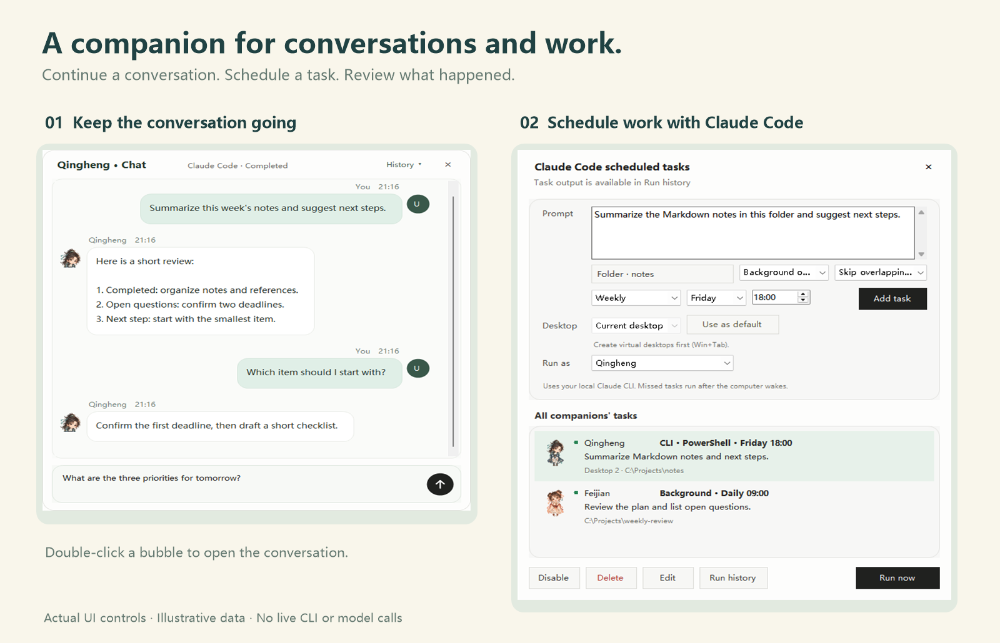

# Companion profiles and scheduled work

[简体中文](COMPANION-PROFILES.zh-CN.md) · [Overview](../README.md)

## Choose a Claude installation for each companion

Open **Default settings** from the companion's context menu. Settings open in a separate window. In **Companions**, select **Global defaults** or a specific companion, then choose:

- **Claude executable**: an existing `claude.exe`, `.cmd` or `.bat` on Windows, or an executable file on Linux. A folder is not an executable.
- **Claude settings file**: an existing Claude JSON settings file. Keep credentials outside the repository.

An empty companion field inherits its corresponding global field. An empty global executable field uses local discovery; an empty global settings field uses Claude's own defaults. These two fields inherit independently. An explicitly configured missing executable or invalid settings file produces an error rather than silently changing the selected profile.

The selection applies to conversations opened by XianPal, manual CLI windows and scheduled runs assigned to that companion. Changing profiles in the settings window keeps unsaved field edits until you apply or cancel. Changes to settings do not reconfigure CLI processes that are already running.

## Assign and review tasks

Open **Claude Code scheduled tasks**, choose **Run as**, and enter the task's own working directory and schedule. The overview includes every companion's tasks, with the original character avatar and owner name on each row.

The task's saved owner determines its executable and settings when a new run starts. Switching the visible desktop companion does not change that assignment. Editing a task's owner affects future runs; earlier run records retain the original owner. Existing tasks without an owner are assigned to the currently selected companion during migration.

**Run history** contains the saved output and status. Double-click a record to read its transcript. Scheduled output does not open a reply bubble or enter ordinary conversations. Native interactive sessions remain active until the CLI session exits; the first response does not complete the task. Claude Background uses the independent CLI's background job lifecycle.

Select **Skip overlapping runs** to keep one run active for a task, or **Allow parallel runs** to start another run at the scheduled time. This does not bypass Claude's folder trust or permission prompts.

## Language and installation

Choose **English** or **简体中文** in **Default settings → General**. The selection is saved; task prompts, file paths and conversation contents are preserved. The Windows installer also includes a language selector, an editable installation folder and animated previews using the same character artwork as the application.

Linux support is still undergoing full migration and target-desktop acceptance. See the [Linux compatibility and acceptance guide](LINUX.en.md) before deploying it.
