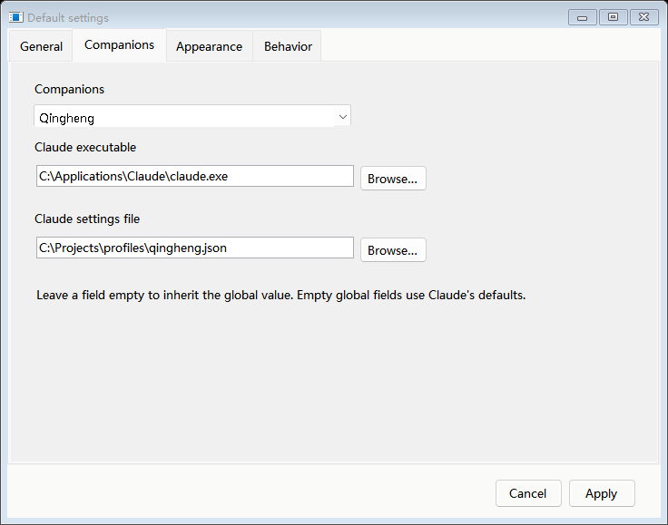
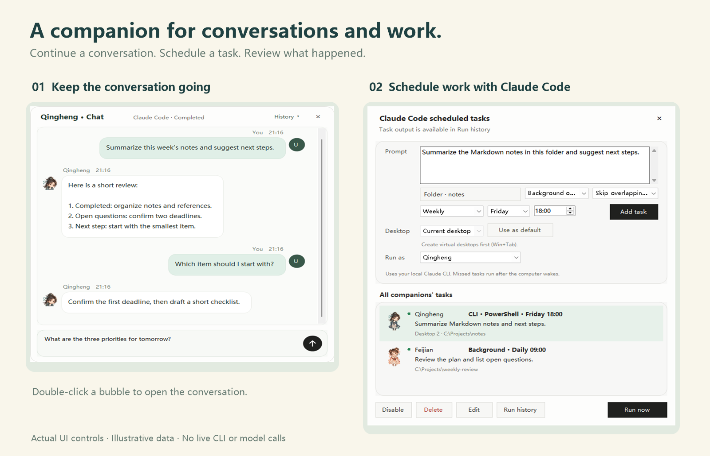

# 道友配置与定时任务

[English](COMPANION-PROFILES.md) · [项目介绍](../README.zh-CN.md)

## 为各道友配置 Claude

右键宠物打开 **默认设置**。设置使用独立窗口，在 **道友** 中选择全局默认或某位道友，分别指定 Claude 可执行文件和 JSON 配置文件。

Windows 可选择已有的 `claude.exe`、`.cmd` 或 `.bat`；Linux 应选择有执行权限的文件。程序地址必须指向文件。角色字段留空时继承对应的全局字段，两项分别继承；全局程序留空时自动查找本机 CLI，全局配置留空时采用 Claude 自身默认设置。显式指定的文件失效会报错，不会悄悄切换为其他道友的配置。

配置用于该道友的新对话、手动打开的 CLI 和所属定时任务。切换设置中的角色会保留尚未应用的输入；取消关闭不保存。已经运行的 CLI 进程不会被重新配置。

## 任务归属和历史

创建定时任务时选择 **执行道友**，并指定任务自己的工作目录和时间周期。任务窗口汇总全部道友，每行显示原始角色头像与姓名。

新运行使用任务保存的道友配置，切换当前桌面宠物不会改变归属。编辑执行道友只影响后续运行，历史记录保留原执行者。旧版未指定归属的任务在升级迁移时归属当前选择的道友。

任务输出仅在 **运行情况** 中查看，双击记录打开完整输出，不弹出桌面对话气泡、不混入普通聊天。原生 CLI 会话保持运行，首次回复不会自动结束任务；Claude Background 按其后台任务生命周期记录状态。

**阻塞模式** 在前一轮仍运行时跳过新触发，**并行模式** 允许到点另开运行。模式不会绕过 Claude 的目录信任和权限确认。

## 语言与安装

在 **默认设置 → 常规** 选择 English 或简体中文。语言会保存，任务提示词、目录和聊天内容保持原文。Windows 安装器同时提供语言选择、自定义安装目录和使用原始人物素材的动画预览。

Linux 仍在完成移植及目标桌面验收，部署前请查看 [Linux 适配说明](LINUX.md)。
