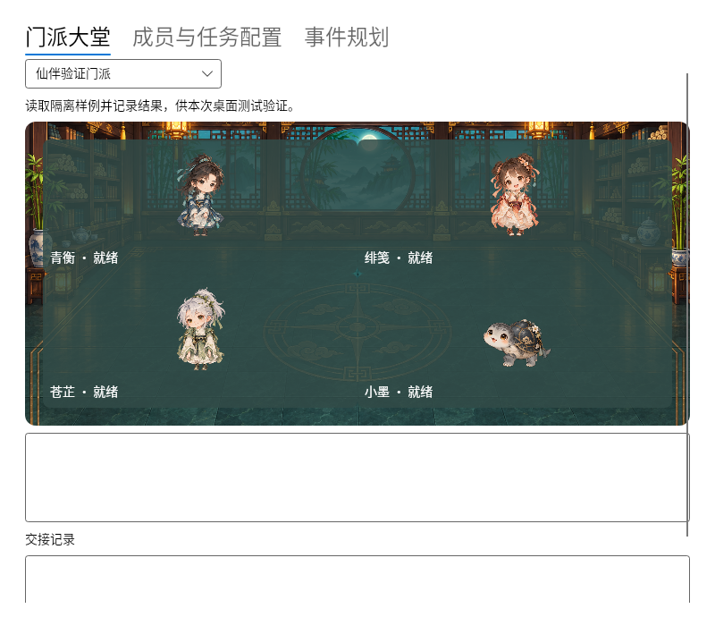

# Linux desktop port and compatibility

[中文](LINUX.md) · [Project overview](../README.en.md)

The `linux` branch contains the Linux desktop port. It shares character packs,
Claude configuration, scheduling, reminders and agent dependency execution with
the Windows application. Full migration and release acceptance are still in progress.

## Build families

| Build | Intended use | Current verification |
| --- | --- | --- |
| Modern x64 / ARM64 | Recent glibc-based distributions; .NET 10 and Avalonia 12 | Native Ubuntu 22.04 and 24.04 runners, X11 windows, shared services and glyph coverage |
| Compatibility x64 | Older system libraries; .NET 8 and Avalonia 11 with private C++ libraries | CentOS 7.9 userspace with glibc 2.17, X11 windows, shared services and glyph coverage |

Compatibility tests are application tests, not a change to upstream OS or runtime
support policies. Prefer the modern build when the system permits it. The legacy
build requires a separate runtime maintenance plan before release.

The expanded CI matrix adds Debian 11/12/13, Ubuntu 20.04, Rocky Linux 8/9,
AlmaLinux 8/9 and openSUSE Leap 16 on x64, and Debian 12/13 on native ARM64 hosts.
These additional cases are awaiting result review. Containers validate userspace
libraries and share the host kernel. They do not validate a distribution's original
kernel, every desktop environment or the target TurboVNC session.

[Validation including bundled Chinese and emoji fonts](https://github.com/AHuaWinliver/xianpal-ai-companion/actions/runs/42436968032)



## Build

```sh
python3 src/DesktopTasks/XianPal.Linux/fetch-fonts.py build/linux-resources/fonts
dotnet publish src/DesktopTasks/XianPal.Linux -r linux-arm64 --self-contained true -c Release -o build/linux-app
build/linux-app/xianpal --self-test
```

Character assets are generated with the existing Windows artwork tools. CI transfers
the approved `assets/`, `scenes/` and `performances/` resources into the Linux output.
The pinned Noto CJK and Color Emoji fonts are embedded in both builds; their OFL 1.1
licenses and source checksums accompany the resources in `fonts/`. Only the build
machine downloads fonts. The installed application makes no font download requests.

For the legacy x64 candidate:

```sh
dotnet publish src/DesktopTasks/XianPal.Linux -p:LinuxCompat=true -r linux-x64 --self-contained true -c Release -o build/linux-compat-x64
python3 src/DesktopTasks/XianPal.Linux/bundle-runtime.py build/linux-compat-x64
build/linux-compat-x64/launch.sh --self-test
```

`bundle-runtime.py` verifies fixed SHA256 hashes, stages application-private C++
libraries in `runtime/`, and includes the GCC license, runtime exception and source
recipes. `launch.sh` loads them for this application. No system library is replaced.

## Intranet deployment

The current target is CentOS 7 x86_64, kernel 3.10.0-1160.el7, glibc 2.17 and an
X11 desktop through TurboVNC. Claude is under `~/APP/claude`. This differs from the
Windows build machine and modern CI hosts.

Prepare the complete package and its architecture-specific native dependencies on
a connected machine. The self-contained application does not need an installed
.NET SDK, Node.js or Python at runtime. The user's independent Claude installation
may need its own runtime. Native ICU, OpenSSL, Fontconfig and X11 libraries remain
system dependencies; copy approved offline packages for the exact target OS rather
than running a network installer on the intranet machine.

Read-only inventory:

```sh
sh src/DesktopTasks/XianPal.Linux/diagnose-linux.sh
```

Use the current graphical session and its `DISPLAY`. The current build uses X11;
Wayland sessions need XWayland. For a VNC session with unusable GLX, select CPU
rasterization before launch:

```sh
XIANPAL_RENDERER=software ./launch.sh
```

An unset renderer uses GLX with software fallback. Chinese and emoji fonts are
bundled, so replacing system fonts is unnecessary. State uses the user's XDG state
directory; external character packs use the XDG data directory's `xianpal/Characters/`.

## Remaining acceptance

The port still needs native terminal and Claude Background modes, tray and startup
integration, AI movement and light trails, artifact travel, external-character
performances, and real desktop input, scaling and multi-monitor acceptance. Existing
automated tests use an isolated fake CLI and never submit model requests. Successful
smoke tests do not establish complete Windows feature parity.

The target's kernel 3.10, actual Claude installation and TurboVNC must be checked on
the intranet desktop before claiming that environment is fully supported. See the
[full acceptance checklist](LINUX.md#发布验收).
