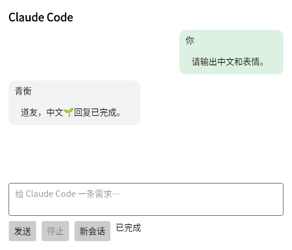
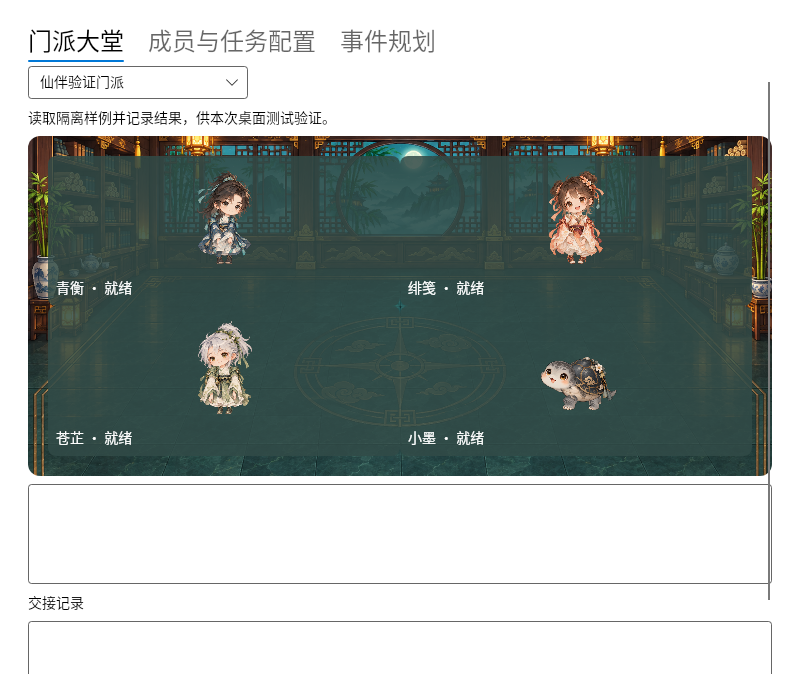

# Linux 移植与兼容性

[English](LINUX.en.md)

Linux 桌面端在 `linux` 分支开发，复用 Windows 端的角色配置、任务调度、提醒与门派依赖执行代码。发布条件是功能移植和目标平台的原生验证全部通过。

## 目标环境与兼容构建

当前内网部署目标为 CentOS 7、x86_64、内核 3.10.0-1160.el7、glibc 2.17、GCC 4.8.5，通过 TurboVNC 使用 X11。目标机已有 Node.js 18.20.15、Python 3.10.14，Claude Code 位于 `~/APP/claude`。

现代构建使用 .NET 10 与 Avalonia 12。兼容构建通过 `-p:LinuxCompat=true` 选择 .NET 8 与 Avalonia 11，单独验证旧 glibc 环境，发布时分别标明运行时和原生依赖。两种构建共享人物、对话、任务和门派逻辑。

CI 已覆盖 12 个系统版本、16 组系统与架构组合。Ubuntu 22.04、24.04 使用原生 x86_64 与 ARM64 runner；其他系统使用对应架构主机上的固定镜像验证用户空间。容器复用 CI 主机内核，目标机的 3.10 内核与 TurboVNC 仍需实际验收。

```sh
# 旧系统兼容候选
python3 src/DesktopTasks/XianPal.Linux/fetch-fonts.py build/linux-resources/fonts
dotnet publish src/DesktopTasks/XianPal.Linux -p:LinuxCompat=true -r linux-x64 --self-contained true -c Release -o build/linux-compat-x64
python3 src/DesktopTasks/XianPal.Linux/bundle-runtime.py build/linux-compat-x64
build/linux-compat-x64/launch.sh --self-test

# 在部署目标上采集环境信息
sh src/DesktopTasks/XianPal.Linux/diagnose-linux.sh
```

兼容包将 C++ 运行库放在应用的 `runtime/` 下，由 `launch.sh` 为该进程加载。制作机在打包时下载固定版本并核对 SHA256，同时附带 GCC 运行库许可、例外条款及构建配方。部署机使用已准备好的文件，不需要在内网执行下载脚本。

两种构建内嵌 Noto 简体中文与彩色表情字体，使用 SIL Open Font License 1.1；字体许可及来源清单保留在资源包 `fonts/` 目录。字体仅在制作机下载并校验固定 SHA256，运行时无需联网，也无需修改系统字体。

应用兼容性测试不会改变上游系统和运行时的支持周期。可运行现代构建的机器优先使用现代构建；CentOS 7 兼容候选的旧运行时需要在发布前单独确认后续维护方案。

## 内网与 VNC 启动

自包含应用运行时不需要另装 .NET SDK、Node.js 或 Python；独立安装的 Claude CLI 仍可能需要其自身运行环境。系统的 ICU、OpenSSL、Fontconfig、X11 等原生库仍需具备，离线依赖包应按目标发行版及架构准备。不要在部署机运行字体或 C++ 运行库的制作脚本。

当前使用 X11，Wayland 会话需要 XWayland。TurboVNC 等会话若有不可用的 GLX 上下文，可显式选择 CPU 绘制。

```sh
XIANPAL_RENDERER=software ./launch.sh
```

未设置时默认尝试 GLX，并保留软件绘制回退。环境检查脚本会列出图形会话、显示器、原生库、终端及 Claude 路径，不安装包、不调用模型。

## 兼容性验证范围

| 系统 | 架构 | 进展 |
| --- | --- | --- |
| Ubuntu 22.04、24.04 | x86_64、ARM64 | 原生 runner 上的构建、共享逻辑、X11 窗口与字形校验通过 |
| CentOS 7.9，glibc 2.17 | x86_64 | 固定镜像内的共享逻辑、X11 窗口、中文与彩色表情校验通过 |
| Debian 11、12、13；Ubuntu 20.04 | x86_64 | 现代构建在固定镜像内的共享逻辑、软件绘制、X11 窗口与字形校验通过 |
| Rocky Linux 8、9；AlmaLinux 8、9 | x86_64 | 现代构建在固定镜像内的共享逻辑、软件绘制、X11 窗口与字形校验通过 |
| openSUSE Leap 16 | x86_64 | 现代构建在固定镜像内的共享逻辑、软件绘制、X11 窗口与字形校验通过 |
| Debian 12、13 | ARM64 | 现代构建在原生 ARM64 主机上的固定镜像内验证通过，无架构模拟 |

以上 16 组检查全部通过，验证构建、系统库加载与模拟 CLI 下的桌面行为，不能替代真实模型服务、目标内核、窗口管理器、显卡驱动或 TurboVNC 验收。[完整矩阵验证记录](https://github.com/AHuaWinliver/xianpal-ai-companion/actions/runs/42438749416)

检查覆盖四位角色加载、Unicode 流式对话、独立任务运行记录、提醒与全屏演绎窗口、四道友依赖交接，以及中文和彩色表情字形。CentOS 7 与扩展发行版矩阵显式使用软件绘制；Ubuntu 原生矩阵使用默认渲染配置。Debian 11 测试依赖从官方归档获取，并保留包签名校验。

Ubuntu x64 与 ARM64 上已通过程序构建、共享业务逻辑和原生窗口自动化检查，CentOS 7 x64 上也通过了对应用户空间检查。界面测试在 Xvfb 与窗口管理器中使用模拟 Claude，验证四个人物加载、中文与表情流式回复、后台任务独立记录和四道友依赖交接。以下是字体修复后的 CentOS 7 测试画面。





原生终端保留 Claude 的交互界面与 TTY 输入；定时任务按所选道友独立调用程序和配置，Background 状态与日志不进入普通聊天。当前还提供中英文独立设置窗口、用户自启动、托盘隐藏恢复，以及带角色动画预览和自定义目录的安装窗口。再次启动程序也能恢复隐藏的宠物。

`sh install.sh` 打开安装窗口，或使用 `sh install.sh --silent --install-dir "$HOME/.local/opt/xianpal"` 安装到指定目录。安装逐文件校验复制内容，升级时完整保留上一安装目录，拒绝覆盖不属于本应用的非空目录。用户数据和外置角色仍位于 XDG 目录。安装前需关闭宠物，安装器不会自动结束独立 Claude 任务。托盘显示还取决于桌面环境的 StatusNotifierItem / AppIndicator 支持。

候选版已接入共享24相位运动、长途灵器、批量AI路线、主动关怀、光轨与外置人物演绎。原生测试验证双向步态、取消、100%不透明度吸附、倒计时到达位置，以及一次模拟CLI请求缓存24条路线。光轨要求X11原生鼠标穿透与桌面合成器同时可用，否则停用覆盖层。大堂使用原版清晰人物、桌案和真实交接连线。真实目标桌面的输入、缩放、多显示器、实际Claude与最终视觉验收仍需完成，不能据此宣称完整功能和目标环境全部通过。

## 构建

在项目根目录运行以下命令。

```sh
python3 src/DesktopTasks/XianPal.Linux/fetch-fonts.py build/linux-resources/fonts
dotnet publish src/DesktopTasks/XianPal.Linux -r linux-arm64 --self-contained true -c Release -o build/linux-app
build/linux-app/xianpal --self-test
```

人物原画与动画使用现有 Windows 素材生成工具制作。Linux 构建流程会将这些资源交给原生 ARM64 runner，分别验证业务逻辑与桌面窗口。构建产物中的 `assets/`、`scenes/`、`performances/` 与程序放在同一目录。

统信、麒麟等环境需要按具体发行版、架构与系统库继续验收，不能仅依据名称推断兼容。当前构建面向 glibc 的 x86_64 与 ARM64；Alpine/musl、32 位 x86、龙架构和 MIPS 尚无对应桌面构建。已验证系统的结论也不覆盖所有显卡驱动、显示协议与桌面组合。

运行时数据放在 XDG 状态目录下的 `xianpal/`，角色资源包放在 XDG 数据目录下的 `xianpal/Characters/`。Claude Code 由用户在 Linux 上独立安装与配置。

## 发布验收

| 功能 | 发布前需要验证 |
| --- | --- |
| 人物与桌面互动 | 四位角色、透明边缘、双向步态、悬停、拖动、贴边、隐藏恢复、多显示器与缩放 |
| Claude 对话 | 中文与表情、流式刷新、上下文续接、取消、原生终端、错误与权限提示 |
| 文件请求 | 文件与文件夹拖放、吃文件动作、需求确认与正确工作目录 |
| 定时任务 | 编辑、每日与每周与间隔、阻塞与并行、后台与可见终端、运行情况与历史、重启恢复 |
| 提醒 | 每日提醒、倒计时、四位角色演绎、提示框、稍后提醒、减少动画、单显示器与 Esc |
| 事件与门派 | 事件确认、角色职责与配置、目录隔离、依赖交接、并发限流、取消与中断记录、大堂状态 |
| 角色资源 | 热更新、原子替换、错误资源回退、完整帧数与透明度校验、外置角色演绎 |
| AI 桌面行为 | 主动发言、休息提醒、历史上的今天、批量路线、彩色光轨与长途灵器 |
| 安装与更新 | ARM64 包、依赖、菜单图标、自启动、更新、卸载、离线部署材料与 SHA256 |

自动化桌面验证使用隔离目录和模拟 CLI，截图与测试结果作为 Actions 产物保存。模拟验证通过后仍需检查真实 Linux 桌面会话下的交互和兼容性。

[返回首页](../README.md) · [开发指南](DEVELOPMENT.zh-CN.md)
