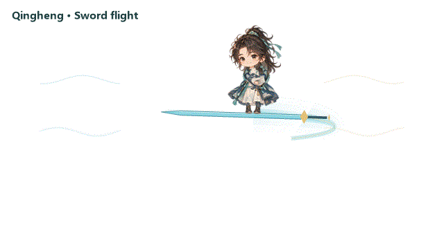

# Companion-specific fullscreen reminders

[简体中文](REMINDER-PERFORMANCES.zh-CN.md)



The four performances use the approved original characters. Effects are drawn behind the complete character, preserving the outermost arms/forelimbs. Read the [customization guide](CHARACTER-CUSTOMIZATION.md) before changing a timeline or attachment.

| Companion | Theme | Motion and scenery |
| --- | --- | --- |
| Qingheng | Sword flight | Summon a sword, stand aboard, follow an arc and land; cyan/gold light tapers behind the blade |
| Feijian | Talisman message | Wave, light hop and settle while eight talismans orbit and reveal their marks |
| Cangzhi | Growing garden | Raise a hand, tend growing vines, then let leaves and glow fade |
| Xiaomo | Ink ripples | Small shell hop, landing ripples, claw greeting and cloud wisps |

## Behavior

Select a character performance in reminders or use the preview button. It uses the currently selected companion and its monitor, not the center of the combined desktop. Entrance ends near 1.12 s, the reminder card appears near 5.60 s and effects finish near 6.24 s. The card remains until dismissed.

Sword flight is active roughly 1.82–5.18 s. The rider stands steadily with the feet attached to the blade; direction and rotation are shared. Popup-only reminders and countdowns keep their lightweight behavior. Reduced motion skips the animated performance. Escape closes/skips and snooze uses the existing reminder service.

These performances do not use screen shatter, giant fists or strong flashes. Legacy state/resource names remain only for compatibility.

## Rendering and previews

`ReminderPerformanceTimeline.cs` defines poses and timing. Windows scenery is in `ReminderPerformance.cs`, shared by live effects and offline previews. The native layered surface uses premultiplied alpha and reusable graphics resources. Failure falls back to an ordinary reminder rather than dropping the notification.

The Linux candidate uses packaged previews for built-ins and a native renderer with the same pose timeline for external packs. External pack frames remain their own; a built-in actor is not substituted. Native effect appearance and target desktop acceptance are checked separately.

```powershell
.\tools\BuildReminderPreviews.ps1
.\tests\reminder-performance-test.ps1
```

Open `build/previews/performances.html` to pause, scrub, replay and inspect reduced motion. The Windows preview uses native-rendered output, not an approximate browser animation. These commands do not create real reminders, call a model, install or publish.

Tests cover poses, timeline boundaries, multiple viewports, alpha, card avoidance, style routing, Escape/dismissal and native surface cleanup. A 16 ms redraw request is not a guaranteed 60 fps on every machine.
