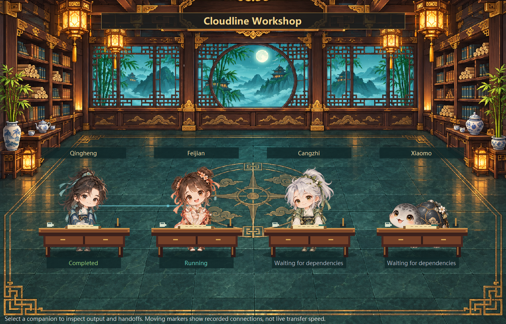

# Event planning and multi-agent workshop

[简体中文](WORKSHOP.zh-CN.md)

The workshop combines manually planned events, editable teams and a visible dependency workflow. Open it from the companion's context menu. Sample teams are not run automatically.

## Plan an event

Set a title, local date/time, recurrence and optional team name. Supported recurrence is `once`, `daily` or `weekly`. An event notifies you and offers a way to open its team; collaboration still requires confirmation.

Events do not wake the computer or execute while the app is closed. Overdue recurring events produce one catch-up notice and advance to a future occurrence. Windows notification settings can hide banners. This is a manual event table rather than a natural-language calendar integration.

## Define a team

Start with the four-companion consultation or development preset, choose a working directory and specify the shared goal, authorized scope and acceptance criteria. See [role presets](COMPANION-ROLES.md).

Each member has a unique ID, name, role, companion and directory. Each task has a unique ID, member ID, prompt and optional comma-separated dependency IDs. IDs are case-insensitive. A team supports up to 12 members and 24 tasks.

| Task | Member | Depends on | Example |
| --- | --- | --- | --- |
| plan | planner | — | Inspect the specified documents and propose a change |
| build | builder | plan | Implement the approved change in the test directory |
| review | reviewer | build | Inspect the result and report findings |

## Execution and handoffs

Confirm the listed directories and model usage before running. Each step starts its own configured local Claude session. At most two steps run at once; identical or nested directories are serialized. Only one workshop workflow runs at a time.

Completed upstream output is summarized into the actual downstream request, with an 8,000-character total handoff budget. It is model-generated context, not new user authorization. Handoffs appear only after being submitted; animated links do not represent hidden reasoning or exact network throughput.

Each step has a ten-minute limit. Failure or timeout blocks dependents while independent branches may continue. Stop cancels this workflow's owned CLI processes; closing the window alone does not. Quitting the pet interrupts local collaboration. Interrupted work is shown after restart and is not automatically replayed.

The scheduler does not bypass tool permissions or provide a filesystem/network sandbox. It does not coordinate file locks with scheduled or manually launched Claude sessions. Separate directories can still access a shared external file. Use isolated worktrees/environments where required; inspect tests before running Bash.

## Hall and history

The hall uses the original transparent companion frames at proportional workstations, with desks, scrolls, tea and an illustrated background. Resize or maximize the window to reflow the scene. The Windows divider adjusts the hall/detail balance. Clicking a member shows its actual prompt, visible output and incoming/outgoing summaries.

Statuses distinguish idle, dependency wait, running, complete, failed and interrupted. The Windows hall keeps at most 24 recent animated cross-member links while detailed history retains the records. It refreshes changed content at most every 300 ms.

`scenes/sect-hall-v2.png` is loaded relative to the app. The Windows app has an embedded fallback. The installer verifies and deploys the scene; it is not dependent on the shell's current directory.

Configuration, events and recent runs are stored in `workshop.json`. Progress is saved periodically; output and history have bounds. Corrupt state disables the module with a notice rather than silently overwriting it. Do not publish these records with source code.

## Development checks

Shared model/scheduler: `SectWorkshop.cs`. Windows UI: `WorkshopForm.cs`, `SectHallControl.cs`, `PetForm.Workshop.cs`. Linux UI: `WorkshopWindow.cs` and its native hall.

Run `tests/workshop-test.ps1`, `tests/hall-layout-test.ps1` and `tests/hall-scene-install-test.ps1` on Windows. Linux CI uses isolated fake agents and actual X11 windows. Real CLI permission, proxy and target desktop acceptance remains separate.
